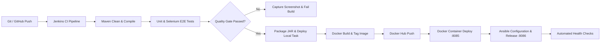

# Property Inspection Workflow (PIW)

[](https://www.oracle.com/java/)
[](https://spring.io/projects/spring-boot)
[](https://www.docker.com/)
[](https://www.jenkins.io/)
[](https://www.selenium.dev/)
[](https://www.ansible.com/)
[](LICENSE)

A full-stack **Property Inspection & Compliance Workflow System** developed as a full-lifecycle DevOps capstone. The platform completely digitizes real-estate and municipal inspection operations—from initial intake and desk review, to on-site field audits, defect cost estimation, legal agreements, billing, and official compliance certification—backed by an automated continuous integration, testing, containerization, and configuration management pipeline.

---

## Table of Contents
- [Key Features](#key-features)
  - [1. Role-Based Access Control (RBAC)](#1-role-based-access-control-rbac)
  - [2. User Authentication & Two-Factor Authentication (2FA)](#2-user-authentication--two-factor-authentication-2fa)
  - [3. End-to-End Property Inspection Lifecycle](#3-end-to-end-property-inspection-lifecycle)
  - [4. On-Site Field Audit & Defect Cost Estimator](#4-on-site-field-audit--defect-cost-estimator)
  - [5. Executive Analytics & Dynamic SVG Charts](#5-executive-analytics--dynamic-svg-charts)
  - [6. Official Certification & Client Feedback](#6-official-certification--client-feedback)
  - [7. Modern UI & Theme Engine](#7-modern-ui--theme-engine)
- [Pre-Seeded Demo Accounts](#pre-seeded-demo-accounts)
- [DevOps Architecture & CI/CD Pipeline](#devops-architecture--cicd-pipeline)
- [Technology Stack](#technology-stack)
- [API Reference](#api-reference)
- [Getting Started & Local Setup](#getting-started--local-setup)
- [Testing & Quality Assurance](#testing--quality-assurance)
- [Docker & Container Deployment](#docker--container-deployment)
- [Configuration Management with Ansible](#configuration-management-with-ansible)
- [Repository Structure](#repository-structure)
- [Known Limitations](#known-limitations)
- [License](#license)

---

## Key Features

### 1. Role-Based Access Control (RBAC)
The interface has four roles:
- **System Administrator (`ADMIN`)**: Full governance oversight, pending user approval/rejection queue, inspector and user directory, macro analytics, and global audit supervision.
- **Certified Field Inspector (`INSPECTOR`)**: Dedicated field dashboard, detailed structural and systems audit checklist, defect logging with cost estimation, photographic evidence upload, and digital license sign-off.
- **Municipal / Agency Reviewer (`REVIEWER`)**: Queue triage, desk review initiation, inspector assignment with scheduled dates and fee quotas, audit review, and formal compliance approval or deficiency notice issuance.
- **Property Owner (`PROPERTY_OWNER`)**: Self-service intake portal, property order placement, saved address quick-fill, pre-inspection legal agreement execution, mock payment checkout, status tracking, and service feedback.

### 2. User Authentication & Two-Factor Authentication (2FA)
- **Administrative Approval Gate**: Self-registered users are placed in a pending verification queue (`approved = false`) until vetted and approved by an Administrator.
- **Two-Factor Authentication (2FA)**: Optional 6-digit Time/Session-based OTP dispatch via SMTP (`JavaMailSender`) to the user's registered email address.
- **Security Safeguards**: OTP validity expiration (5 minutes), attempt rate limiting (max 5 attempts), token-bound verification, email masking, and developer demo credentials fallback.

### 3. End-to-End Property Inspection Lifecycle
- **Status State Machine**:
  $$\text{SUBMITTED} \longrightarrow \text{UNDER\_REVIEW} \longrightarrow \begin{cases} \text{APPROVED} \\ \text{REJECTED} \end{cases}$$
- **Intake & Submission**: Captures property address, property classification (*Residential, Commercial, Industrial, Mixed-Use*), contact details, owner name, urgency (*LOW, MEDIUM, HIGH, CRITICAL*), structural specifications (rooms, floors, square footage, year built), pre-inspection notes, and multi-photo upload with interactive thumbnail previews.
- **Desk Review & Assignment**: Reviewers evaluate intake data, assign certified inspectors from the active roster, specify scheduled inspection dates, configure inspection fees, and append reviewer guidelines.
- **Append-only audit trail**: Every status transition, assignment, inspection audit, agreement signing, payment, and remark is recorded in a chronological, append-only JSON audit trail with timestamps and actor identities.

### 4. On-Site Field Audit & Defect Cost Estimator
- **Multi-System Inspection Checklist**: Standardized checks across seven primary building domains:
  1. *Roofing & Attic*
  2. *Foundation & Structural Elements*
  3. *Electrical Distribution & Panels*
  4. *Plumbing & Drainage*
  5. *HVAC & Ventilation*
  6. *Fire Safety & Egress Routes*
  7. *Exterior Grounds & Site Drainage*
- **Defect Logger & Repair Cost Estimator**:
  - Log findings with severity classifications: **Safety Hazard**, **Major Defect**, **Minor Defect**, or **Maintenance**.
  - Capture repair cost estimates, specific location descriptions, corrective recommendations (*Repair, Replace, Monitor, Specialist Evaluation*), and required trade specialists (*Structural Engineer, Electrician, Plumber, Fire Safety Officer*).
  - Real-time KPI summaries computing safety hazard counts, major defect counts, and total estimated repair expenditure.
- **Inspector Sign-Off**: On-site overall condition rating (*Excellent, Good, Fair, Poor*), professional license number capture, and inspector digital signature endorsement.

### 5. Executive Analytics & Dynamic SVG Charts
Built-in, zero-dependency SVG visualization engine delivering real-time data insights:
- **KPI Summary Cards**: Live counts for Total Orders, Submitted Requests, Under Review Requests, Approved Certifications, and Deficiency Rejections.
- **Status Distribution**: Donut chart illustrating workflow lifecycle progress.
- **Property Type Breakdown**: Categorized bar chart tracking residential, commercial, and industrial property distributions.
- **Submission Trend Timeline**: Chronological line/area visualization mapping intake volume over time.
- **Quality Gate Gauge**: Dynamic approval rate percentage gauge calculating compliance pass ratios.

### 6. Official Certification & Client Feedback
- **Printable Certificate of Inspection**: High-fidelity, print-optimized compliance certificate featuring an official verification seal, dynamic QR verification badge, property specifications, audit rating, defect summary, and inspector/reviewer signatures.
- **Pre-Inspection Legal Agreement**: In-app service agreement modal with terms, liability disclaimers, and mandatory client digital signature.
- **Itemized Invoice & Billing Checkout**: In-app invoice generation showing base fees, applicable taxes, payment status badges, and one-click mock payment settlement (`PAID`).
- **Post-Inspection Client Reviews**: Interactive 5-star customer rating system with qualitative review submissions.

### 7. Modern UI & Theme Engine
- **Fluid Dark / Light Mode**: Smooth theme toggling with CSS design tokens (`--bg`, `--card`, `--navy-dark`, `--primary`, `--green`, `--red`, `--amber`, `--purple`) and persistent styling.
- **Glassmorphic Navigation**: Sticky header with blur effects, user profile avatars, and contextual role hero banners.
- **Responsive Layout**: Designed with typography by Google Fonts (*Plus Jakarta Sans*), micro-interactions, modal dialogs, and real-time client-side search and status filtering.

---

## Pre-Seeded Demo Accounts

The application automatically seeds sample demo users and inspection orders on startup for immediate demonstration and testing:

| Username | Password | Role | Full Name / Description | Default Permissions |
|:---|:---|:---|:---|:---|
| `demo` | `demo123` | **ADMIN** | DevOps System Administrator | Global oversight, user approvals, analytics, full workflow control |
| `rahul_inspector` | `pass123` | **INSPECTOR** | Rahul Verma (Certified Master Inspector) | Field audits, systems checklist, defect logging, sign-off |
| `priya_reviewer` | `pass123` | **REVIEWER** | Priya Deshmukh (Municipal Review Officer) | Review intake, assign inspector, approve / reject compliance |
| `sneha_owner` | `pass123` | **PROPERTY_OWNER** | Sneha Gadhari (Property Owner) | Submit requests, sign agreements, pay invoices, submit feedback |

> **Note**: Self-registration is enabled on the login screen. Self-registered users will remain in a pending state until approved by the `demo` administrator account.

---

## DevOps Architecture & CI/CD Pipeline

The project features a continuous integration and continuous deployment (CI/CD) architecture orchestrated via Jenkins:



### Multi-Stage Jenkins Pipeline (`Jenkinsfile`)
1. **Checkout**: Pulls the target branch from GitHub (`Sneha-Gadhari/property-inspection-workflow`).
2. **Build & Package**: Executes `mvn clean compile` and `mvn package -DskipTests` to assemble the deployable Spring Boot JAR artifact.
3. **Continuous Testing & Quality Gates**:
   - Executes JUnit 5 unit tests and full-suite Selenium headless browser tests (`mvn test`).
   - Archives Surefire JUnit test XML reports.
   - Automatically captures and archives screenshots on test failures (`target/screenshots/*.png`).
4. **Local Windows Deployment**: Manages Windows scheduled tasks (`register-task.ps1`) on port `8081` with clean process termination and health logging.
5. **Containerization**: Builds multi-tagged Docker images (`snehagadhari17/property-inspection-workflow:${BUILD_NUMBER}` and `:latest`).
6. **Docker Hub Registry Push**: Authenticates via Jenkins secure credentials and pushes images to Docker Hub.
7. **Container Orchestration**: Deploys containerized instances on port `8085` and verifies endpoint responsiveness via curl health checks.
8. **Ansible Release**: Executes Ansible playbooks (`release.yml`) inside WSL Ubuntu to provision and validate container release environments on port `8086`.

---

## Technology Stack

- **Backend Core**: Java 21 LTS, Spring Boot 4.1.0 (Web MVC, Data JPA, Validation, Mail)
- **Database**: In-memory H2 Database with automatic schema migrations and CLOB JSON attributes
- **Web Server**: Apache Tomcat (Embedded)
- **Frontend**: Vanilla HTML5, Modern CSS3 with Design Tokens, JavaScript (ES6+ SPA architecture), Google Fonts (*Plus Jakarta Sans*)
- **Testing**: JUnit 5, Spring Boot Test, Selenium WebDriver 4 (Headless Chrome), Surefire
- **CI / CD**: Jenkins Declarative Pipelines, PowerShell automation scripts
- **Containerization**: Docker, Docker Hub, Eclipse Temurin 21 JRE base image
- **Configuration Management**: Ansible Playbooks (`site.yml`, `release.yml`, `inventory.ini`)

---

## API Reference

### Inspection Operations (`/api/inspections`)

| Method | Endpoint | Description | Request / Query Parameters |
|:---|:---|:---|:---|
| `POST` | `/api/inspections` | Submit a new property inspection request | JSON body with property specs & owner data |
| `GET` | `/api/inspections` | Retrieve all inspection requests | None |
| `GET` | `/api/inspections/{id}` | Retrieve a specific inspection request by ID | Path variable `id` |
| `GET` | `/api/inspections/status/{status}` | Filter inspection requests by status | Path variable (`SUBMITTED`, `UNDER_REVIEW`, `APPROVED`, `REJECTED`) |
| `GET` | `/api/inspections/statistics` | Retrieve aggregate metrics and timeline stats | None |
| `PUT` | `/api/inspections/{id}/start-review` | Transition order into desk review | Path variable `id` |
| `PUT` | `/api/inspections/{id}/assign-inspector` | Assign inspector, schedule date, and set fee | JSON with `inspectorName`, `scheduledDate`, `feeAmount`, `remarks` |
| `PUT` | `/api/inspections/{id}/conduct-inspection` | Submit field audit findings & defect records | JSON with checklist, defect list, condition, license, signature |
| `PUT` | `/api/inspections/{id}/sign-agreement` | Record client pre-inspection disclaimer sign-off | JSON with `clientSignature` |
| `PUT` | `/api/inspections/{id}/process-payment` | Process mock inspection fee payment | JSON with `paymentStatus` (`PAID`, `PENDING`) |
| `PUT` | `/api/inspections/{id}/submit-feedback` | Submit post-inspection customer rating | JSON with `clientRating` (1–5) and `clientFeedback` |
| `PUT` | `/api/inspections/{id}/approve` | Formally approve inspection with remarks | Optional JSON with `remarks` |
| `PUT` | `/api/inspections/{id}/reject` | Issue formal deficiency notice rejection | Optional JSON with `remarks` |

### User & Authentication Operations (`/api/users`)

| Method | Endpoint | Description | Request / Query Parameters |
|:---|:---|:---|:---|
| `POST` | `/api/users/register` | Self-register a new user account | JSON with username, password, role, contact details |
| `POST` | `/api/users/login` | Authenticate with username and password | JSON with `username`, `password`, optional `useOtp` flag |
| `POST` | `/api/users/verify-otp` | Verify 6-digit two-factor authentication code | JSON with `tempToken` and `otp` |
| `POST` | `/api/users/resend-otp` | Request a fresh OTP code dispatch | JSON with `username` |
| `GET` | `/api/users/pending` | List pending user registration requests | None |
| `PUT` | `/api/users/{id}/approve` | Approve a pending user account | Path variable `id` |
| `PUT` / `DELETE`| `/api/users/{id}/reject` | Reject and remove a registration request | Path variable `id` |
| `GET` | `/api/users` | List all registered users | None |
| `GET` | `/api/users/inspectors` | List approved inspectors for assignment | None |

---

## Getting Started & Local Setup

### Prerequisites
- **Java Development Kit (JDK)**: Version 21 or higher
- **Maven**: Version 3.9+ (or use the included `./mvnw` wrapper)
- **Google Chrome**: Required for running Selenium UI tests
- **Docker** *(Optional)*: For containerized execution
- **WSL / Ansible** *(Optional)*: For automated deployment playbooks

### Running Locally
1. Clone the repository:
   ```bash
   git clone https://github.com/Sneha-Gadhari/property-inspection-workflow.git
   cd property-inspection-workflow
   ```

2. Build and run the Spring Boot application:
   ```bash
   ./mvnw spring-boot:run
   ```
   *(On Windows cmd/powershell, run `mvnw.cmd spring-boot:run` or `mvn spring-boot:run`)*

3. Access the portal in your browser:
   ```
   http://localhost:8081
   ```
   *(Port `8080` is reserved for Jenkins to avoid port collisions)*

4. Log in using any of the pre-seeded demo accounts (e.g., `demo` / `demo123` or `rahul_inspector` / `pass123`).

---

## Testing & Quality Assurance

The codebase includes comprehensive unit and Selenium end-to-end integration test suites:

```bash
# Run all unit and integration tests
mvn test

# Run a specific Selenium test suite
mvn test -Dtest=WorkflowJourneyTest
mvn test -Dtest=NewFeaturesSeleniumTest
mvn test -Dtest=LoginTest
mvn test -Dtest=OtpServiceTest
```

### Automated Selenium Quality Gates
- **`WorkflowJourneyTest`**: Tests full cross-role lifecycles: user registration → admin approval → property owner submission → reviewer assignment → field inspection → reviewer approval with remarks.
- **`NewFeaturesSeleniumTest`**: Validates SVG analytics charts, dark mode toggle, audit modals, and owner portal interactions.
- **`LoginTest`**: Verifies RBAC authorization, credential validation, and rejection handling.
- **`OtpServiceTest`**: Validates OTP generation, rate limiting, and session expiration behavior.
- **`ScreenshotOnFailure`**: JUnit 5 test watcher automatically capturing high-resolution PNG browser snapshots into `target/screenshots/` whenever any UI test assertion fails.

---

## Docker & Container Deployment

### Build and Run with Docker
```bash
# 1. Package the Spring Boot JAR
mvn clean package -DskipTests

# 2. Build the Docker image
docker build -t snehagadhari17/property-inspection-workflow:latest .

# 3. Run the container
docker run -d --name piw-app -p 8085:8081 snehagadhari17/property-inspection-workflow:latest

# 4. Verify container health
curl -I http://localhost:8085/
```

Access the containerized instance at `http://localhost:8085`.

---

## Configuration Management with Ansible

Ansible playbooks are located in the `ansible/` directory to manage multi-environment container deployments:

```bash
# Navigate to ansible directory
cd ansible

# Run base configuration playbook
ansible-playbook -i inventory.ini site.yml

# Execute container release deployment
ansible-playbook -i inventory.ini release.yml -e "new_tag=latest"
```

---

## Repository Structure

```
property-inspection-workflow/
├── .mvn/                                # Maven wrapper configuration
├── ansible/                             # Ansible configuration management
│   ├── inventory.ini                    # Inventory definition
│   ├── release.yml                      # Release playbook with health check and automatic rollback
│   └── site.yml                         # Base provisioning playbook
├── Project documentation/               # Weekly deliverables (Weeks 1-15) & architecture
├── src/
│   ├── main/
│   │   ├── java/com/propertyinspection/propertyinspectionworkflow/
│   │   │   ├── EmailService.java        # SMTP mail dispatch for 2FA OTP codes
│   │   │   ├── InspectionRequestController.java  # REST API controller for inspections
│   │   │   ├── InspectionRequestRepository.java  # JPA Data repository for inspections
│   │   │   ├── OtpService.java          # In-memory OTP session manager & rate limiter
│   │   │   ├── PropertyInspectionWorkflowApplication.java # Spring Boot entry & data seeder
│   │   │   ├── UserController.java      # REST API controller for RBAC & authentication
│   │   │   ├── UserRepository.java      # JPA Data repository for user accounts
│   │   │   └── model/
│   │   │       ├── InspectionRequest.java # Inspection entity with audit trail & defect JSON
│   │   │       └── User.java            # User entity with roles, approvals, and credentials
│   │   └── resources/
│   │       ├── application.properties   # Port configuration & SMTP mail settings
│   │       └── static/
│   │           └── index.html           # Full-featured Single Page Application (SPA)
│   └── test/
│       └── java/com/propertyinspection/propertyinspectionworkflow/
│           ├── BaseSeleniumTest.java    # Shared Headless Chrome driver & helpers
│           ├── LoginTest.java           # Authentication & RBAC UI tests
│           ├── NewFeaturesSeleniumTest.java # Analytics, charts, and details modal tests
│           ├── OtpServiceTest.java      # Unit tests for OTP security verification
│           ├── PropertyInspectionWorkflowApplicationTests.java # Context loading test
│           ├── ScreenshotOnFailure.java # JUnit test watcher for screenshot capture
│           └── WorkflowJourneyTest.java # Complete end-to-end multi-role workflow test
├── Dockerfile                           # Eclipse Temurin 21 JRE container specification
├── Jenkinsfile                          # 9-stage declarative CI/CD pipeline
├── deploy.bat                           # Local Windows scheduled task deployment script
├── register-task.ps1                    # PowerShell task scheduler helper
├── run-app.ps1                          # App runner background script
└── pom.xml                              # Maven project descriptor & dependencies
```

---

## Known Limitations

- **API-Level Authorization**: Role-based access control and persona separation are enforced at the client interface layer; backend REST endpoints currently do not enforce centralized token/session interceptors or Spring Security guards (e.g., endpoints can be invoked directly without active authentication tokens).
- **Deployment Strategy**: Container deployment via Ansible (`release.yml`) performs in-place container replacement with automated health checking and rollback rather than zero-downtime blue/green traffic routing across parallel environments.
- **Audit Trail Persistence**: The audit trail records status transitions and user actions as an append-only JSON structure in the database; records are not cryptographically signed or backed by an immutable ledger.
- **In-Memory Storage**: The application utilizes an embedded H2 database for demonstration and automated testing convenience, meaning state resets when the application process is stopped.

---

## License
This project is licensed under the MIT License — see the [LICENSE](LICENSE) file for details.